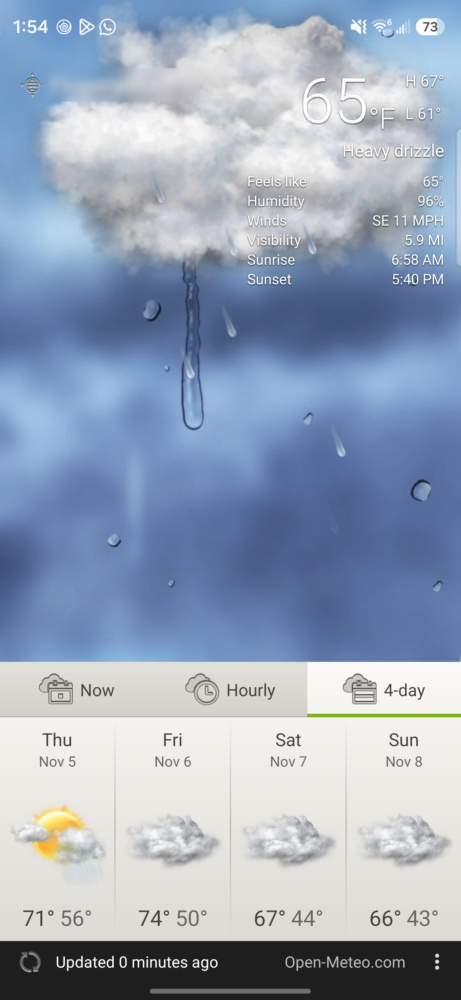

# HTC Sense 4 Weather (Android)

The **HTC One X (Sense 4) Weather app** rebuilt for **modern Android**, with its animated weather scenes, Now / Hourly / 4-day tabs and Sense 4 home-screen widgets. Weather comes from **Open-Meteo**: no AccuWeather or HTC account, no API key.

**Works with the [HTC Weather Flip Clock](https://github.com/neptaligonzalez7-afk/htc-weather-flip-clock):** with this app installed, tapping the weather on the flip clock (v1.2.11+) opens Sense 4 Weather instead of the weather.com page.

> **Not affiliated with HTC.** Community rebuild of the One X weather app for phones where the original no longer runs.

## Screenshots

| Weather app |
|-------------|
|  |

Location name is blurred for privacy.

## What it does

| Area | Details |
|------|---------|
| **Animated weather scenes** | The One X's sky backdrops and animated condition scenes (sun, clouds, rain, snow, fog, storms, day and night), cross-fading when the weather changes. **Fit screen** or **Full screen** from the menu. |
| **Today at a glance** | Current temperature, high and low, condition, feels like, humidity, wind, visibility, sunrise and sunset. |
| **Now / Hourly / 4-day tabs** | Today, tonight and tomorrow; an hourly temperature curve; and the next four days with HTC's forecast icons. |
| **Cities** | Up to 15 cities. Swipe **up and down** to switch between them, as on Sense 4. Search to add a city, use **Find current location**, and reorder or delete cities in **Edit list**. |
| **Units** | °F or °C; miles or kilometres follow the unit you pick. |
| **Weather data** | [Open-Meteo](https://open-meteo.com/) forecast and city search. Refreshes when you open the app and about once an hour for widgets. |

## Widgets

The app also brings the Sense 4 home-screen widgets. Long-press the home screen → **Widgets** → **Sense 4**.

| Widget | What it shows |
|--------|---------------|
| **Weather** | Today and the next four days |
| **Weather (small)** | Current conditions with the day's high and low |
| **Weather (extra small)** | Temperature at a glance |
| **Clock** | The One X's analog clocks; pick a face when you add it |
| **World clock** | The time in another city |
| **Dual clock** | Local time beside another city |
| **Digital clock** | Time and date with your home city |
| **Flip clock (small)** | Flip clock beside the weather |
| **Flip clock + headlines** | Flip clock over the latest top stories ([NPR](https://www.npr.org/) news feed) |
| **Ring clock** | Rings of hours, minutes and seconds |
| **Spin clock** | LCD time inside spinning arcs |

For HTC's big **4×2 weather flip clock**, install the [HTC Weather Flip Clock](https://github.com/neptaligonzalez7-afk/htc-weather-flip-clock) alongside this app.

## Using it with the flip clock

1. Install this app and the [HTC Weather Flip Clock](https://github.com/neptaligonzalez7-afk/htc-weather-flip-clock/releases/latest) (v1.2.11 or newer).
2. Tap the weather icon, temperature or condition on the flip clock. Sense 4 Weather opens.

The two apps keep their own city lists: the app opens on its first city, not necessarily the flip clock's city. If you uninstall this app, the flip clock goes back to opening weather.com.

## Download

Get the latest APK from **[Releases](https://github.com/neptaligonzalez7-afk/htc-sense4-weather-app/releases)**.

| Release | File | versionCode | Notes |
|---------|------|-------------|-------|
| **Latest (Nov 2026)** — tag **`v0.2.2`** | `Sense4-Weather-v0.2.2.apk` | `4` | First public release |

## Requirements

- Android **12+** (API 31) through **current Android** (targets **API 36**)
- Internet for weather
- Location permission optional (for **Find current location**)

## Install

1. Download the latest APK from **Releases**.
2. On the phone: allow **Install unknown apps** for your browser or Files app.
3. Open the APK and install.
4. Open **Sense 4 Weather** from the app drawer and add a city, or tap **Find current location**.

Developers: `adb install -r Sense4-Weather-v0.2.2.apk`

## Signing

APKs are **debug-signed** for sideloading. They are not Play Store builds. Updates from this repo install over each other; to switch from a differently signed build, uninstall it first.

## License

See [LICENSE](./LICENSE). HTC Sense names and assets are trademarks of their respective owners.

## Reporting issues

Open a **GitHub Issue** with device model, **Android version**, launcher name, the **APK filename** (from Releases) and a screenshot or short screen recording.

## Support (optional)

If this app is useful on your phone, you can [buy me a coffee](https://buymeacoffee.com/neta4457). Thanks for trying it.
